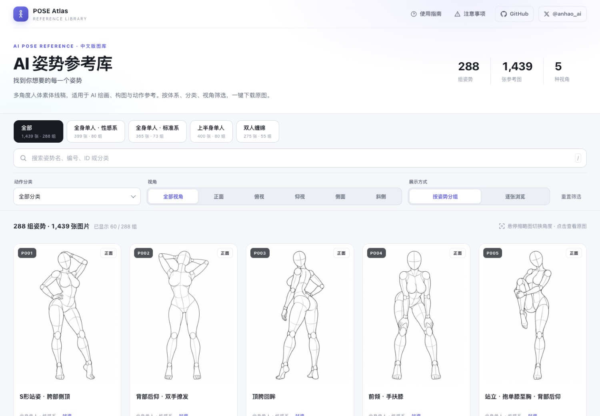
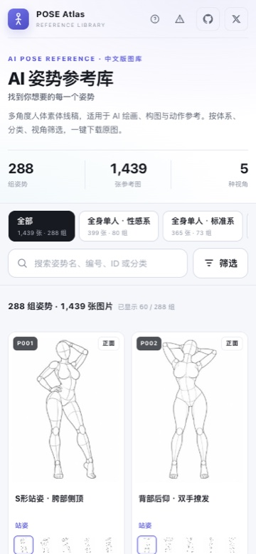

# AI Pose Gallery · PL/EN

> 288 grup / 1439 referencji poz do AI — **interfejs po polsku**, **tagi i nazwy poz po angielsku** (pod promptowanie). Zero zależności, statyczna galeria.



<details><summary>Podgląd mobilny</summary>



</details>

**Oryginał (JP):** <https://ai-pose-gallery.pages.dev/>  
**Fork chiński (źródło tego forka):** <https://github.com/anhao/ai-pose-gallery-zh> · demo <https://ai-pose-gallery.anhao.app/>  
**Autor obrazów / danych:** ギア（@giaaibusi）  
**Fork ZH:** Anhao  
**Wersja PL/EN:** Nozownik

---

## Co to jest

1. **UI po polsku** — przyciski, filtry, puste stany, instrukcja, uwagi, meta.
2. **Tagi poz po angielsku** — system, kategoria, nazwa pozy, kąt — tak, żeby dało się kopiować do promptów AI (chiński fork przetłumaczył też tagi na CHI; tu przywrócone / przetłumaczone na EN).
3. **Zero-dependency** — jeden `index.html` + JSON; bez bundlera.

## Jak uruchomić lokalnie

Galeria ładuje JSON przez `fetch`, więc potrzebuje HTTP (sam `file://` nie wystarczy):

```bash
cd ai-pose-gallery-pl
python3 -m http.server 8000
# otwórz http://127.0.0.1:8000
```

### Obrazki (thumbs / img)

Ten checkout **nie zawiera** ~660 MB obrazów (`thumbs/`, `img/`).

Domyślnie galeria bierze pliki z CDN oryginału:

`https://ai-pose-gallery.pages.dev/`

Opcje:

| URL | Zachowanie |
| --- | --- |
| `http://127.0.0.1:8000/` | obrazki z CDN oryginału |
| `http://127.0.0.1:8000/?assets=local` | tylko lokalne `thumbs/` i `img/` |
| `?assets=https://twoj-cdn/` | własna baza URL |

Pobranie lokalnej kopii obrazów (opcjonalnie):

```bash
python3 scripts/download.py
# potem: http://127.0.0.1:8000/?assets=local
```

## Dane

| Plik | Opis |
| --- | --- |
| `data/pose-en.json` | **Frontend** — 1439 rekordów, pola i wartości EN |
| `data/meta-en.json` | Lista systemów (EN) |
| `data/translations-en.csv` | JP → EN (323 unikalne frazy) |
| `data/pose.json` | Oryginał JP (nietknięty) |
| `data/pose-zh.json` / `meta-zh.json` | Fork chiński (zostawione do porównania) |

Pola w `pose-en.json`:

| Pole | Przykład | Znaczenie |
| --- | --- | --- |
| `id` | `full_sexy_P001_front` | ID |
| `system` | `Full body solo · Sexy` | linia / system |
| `poseNumber` | `P001` | numer grupy |
| `category` | `Standing` | kategoria ruchu |
| `poseName` | `S-curve standing, hip cocked to the side` | nazwa pozy (EN, pod prompt) |
| `angle` | `Front` | kąt |
| `thumb` / `full` | `thumbs/…` / `img/…` | ścieżki względne |
| `search` | sklejka EN | wyszukiwanie |

Regeneracja EN z mapy JP→EN:

```bash
python3 scripts/apply_en.py
```

Słownik: `scripts/i18n_en.py`.

## Funkcje strony

- 4 systemy (zakładki) ze zliczaniem zdjęć / grup  
- Szukaj po nazwie EN, numerze, ID, kategorii (`/` fokusuje pole)  
- Filtry: kategoria, kąt, grupowanie vs pojedyncze zdjęcia  
- Lightbox: miniatury → PNG 900×1200, kopiuj ID, pobierz, nowa karta  
- `←/→` kąt, `↑/↓` poza, `Esc` zamknij; na telefonie swipe  

## Uwagi prawne (skrót)

Obrazy i dane: ギア. Zasady oryginału: OK do tworzenia prac (także komercyjnych) jako referencja; **zakaz redystrybucji / odsprzedaży samych plików obrazów**. Szczegóły — oryginalna strona i README forka ZH.

## Licencja

Zobacz `LICENSE` (jak w upstreamie). Ten fork dodaje lokalizację PL UI + słownik EN tagów.
